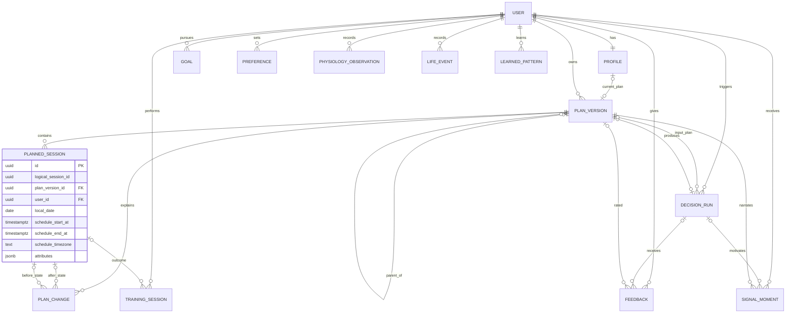

# SIGNAL Canonical Data Model

Status: design proposal. This document defines the logical PostgreSQL model for SIGNAL; it is not a migration or ORM specification. It follows the product and privacy requirements in [`SIGNAL_SPEC.md`](../SIGNAL_SPEC.md).

## Modeling conventions

- Primary identifiers are UUIDs. Timestamps are `timestamptz` in UTC; user-facing dates and event-local times are interpreted with the profile's IANA time zone.
- Use PostgreSQL enums or constrained text for the finite values shown below. Prefer constrained text where values are likely to evolve. Store quantities with explicit units; never infer units from a number.
- `JSONB` is limited to versioned, validated snapshots or bounded structured payloads whose shape legitimately varies. Core queryable facts remain typed columns.
- Required means non-null for a persisted record. Server-generated IDs and timestamps are required even when users do not supply them.
- Sensitivity classes: **D** direct identifier/account secret; **S** sensitive personal/physiological data; **P** personal application data; **I** internal operational metadata; **Derived** derived decision context (may still be sensitive). AI allowance is task-scoped: an allowed field may enter only through the explicit `AIContext` allowlist and only when needed.
- “Not allowed” means never included in an LLM prompt. The deterministic engine may access identity-independent data under the authenticated user's scope.
- User-owned rows carry a `user_id` foreign key unless noted. Authorization must scope reads and writes by the authenticated identity, not by an AI-provided identifier.

## Identity and application data separation

`User` is the identity-plane principal and contains only opaque identity linkage and account lifecycle metadata. Authentication credentials and contact details belong to an identity/auth provider or a separately protected identity store; they are not planner inputs. All domain entities reference `User.id` as a storage/authorization boundary. Before invoking an LLM, the server resolves records by that ID, derives a minimal context, removes the identifier, and serializes only allowlisted fields into `AIContext`.

## Core Data Invariants

- Every user-owned record and every relationship between user-owned records is scoped to the authenticated user. A supplied `user_id` is never trusted as authorization.
- `PlanVersion` schedule content and its `PlannedSession` rows are immutable once created. Only the controlled lifecycle state may transition (`proposed` to `accepted`/`rejected`, or the former accepted current version to `superseded`). Corrections produce a new plan version.
- Every `PlannedSession`, including rest/recovery entries, has a required typed `schedule_window` with timezone-aware `start_at` and `end_at` plus a valid IANA `timezone`; `end_at` is strictly after `start_at`. Overlap and conflict detection compare the normalized absolute instants represented by `start_at`/`end_at`, not local-date or wall-clock strings.
- `Profile.current_plan_version_id` is the sole current-plan pointer. It is nullable before a first plan exists and references at most one version; once initialized, exactly one plan is current for that user.
- Promoting a proposal is one database transaction: lock the user's planning/profile row, verify the proposed version belongs to that user and its latest validation succeeded, mark the former current version `superseded`, mark the proposal `accepted`, and update the pointer. A rejected proposal stays `rejected` and does not change the pointer. A new proposal does not supersede the current plan until accepted. Concurrent acceptances serialize on the same user-owned state row and re-check the parent/current version before commit.
- LLM output cannot introduce facts, sessions, constraints, or candidate IDs absent from deterministic inputs. A proposed plan cannot become current unless deterministic validation succeeds.
- `AIContext` contains only fields explicitly allowed by its versioned serializer schema. Raw free-text user content never enters a prompt without explicit sanitization and structuring; default is to exclude it.
- A `LearnedPattern` cannot outrank an explicit user preference and cannot influence a decision until its evidence and confidence meet the configured threshold.
- Historical decisions remain reproducible through versioned engine, policy, validator, prompt/context schema, and snapshot schema metadata, while retaining only minimized audit evidence.
- PostgreSQL plus typed application/domain models are sufficient for the MVP. This design introduces no vector database, event sourcing, Kafka, Redis requirement, CQRS, microservices, extra ORM abstraction, or unnecessary tables.

## Entities

### User

**Purpose:** Identity-plane anchor for account ownership and lifecycle. It is not a profile and is never serialized to AI.

| Field | Type | Required | Key | Sensitivity | AIContext | Derivation |
|---|---|---:|---|---|---|---|
| `id` | UUID | Yes | PK | D, opaque identifier | No | Generated |
| `identity_subject` | TEXT | Yes | Unique | D | No | Opaque subject from auth boundary; do not expose externally |
| `created_at` | TIMESTAMPTZ | Yes |  | I | No | Server clock |
| `status` | TEXT enum (`active`,`disabled`,`deletion_pending`,`deleted`) | Yes |  | I | No | Lifecycle workflow |
| `deleted_at` | TIMESTAMPTZ | No |  | I | No | Set by deletion workflow |

**Indexes:** Unique `(identity_subject)`; PK. **Relationships:** one-to-one Profile; one-to-many all user-owned entities. **Example:** `{id:"u-uuid", identity_subject:"opaque-subject-42", created_at:"2026-09-23T10:00:00Z", status:"active", deleted_at:null}`. **Retention:** account lifecycle and legal obligations determine retention; deletion should cascade or anonymize associated records per policy, with backups expiring on a defined schedule. Never retain credentials here. **Cache:** account disable/delete invalidates every user-scoped cache namespace; the opaque ID is acceptable in internal cache keys but not model prompts.

### Profile

**Purpose:** Stable planning context and units/time-zone configuration; sensitive attributes are kept distinct from identity.

| Field | Type | Required | Key | Sensitivity | AIContext | Derivation |
|---|---|---:|---|---|---|---|
| `user_id` | UUID | Yes | PK, FK → User.id | D linkage | No | User account |
| `current_plan_version_id` | UUID | No | FK → PlanVersion.id | P | No | Pointer maintained transactionally; null until an initial plan is accepted |
| `timezone` | TEXT (IANA zone) | Yes |  | P | Derived contextual value only if needed | User-selected; validate against zone database |
| `preferred_units` | TEXT enum (`metric`,`imperial`) | Yes |  | P | Yes, if relevant | User-selected |
| `birth_date` | DATE | No |  | S | No | User-provided; derive age-band if necessary |
| `sex` | TEXT enum/controlled vocabulary | No |  | S | No by default | User-provided; use internally only if relevant |
| `height_cm` | NUMERIC(5,2) | No |  | S | No by default | User-provided |
| `weight_kg` | NUMERIC(5,2) | No |  | S | No by default | User-provided/dated measurement should preferably be a PhysiologyObservation |
| `training_experience` | TEXT enum (`new`,`some`,`experienced`,`unknown`) | No |  | S/P | Possibly, task-scoped | User-provided; do not infer without evidence |
| `created_at` | TIMESTAMPTZ | Yes |  | I | No | Server clock |
| `updated_at` | TIMESTAMPTZ | Yes |  | I | No | Server clock |

**Indexes:** PK only, plus the FK lookup for `current_plan_version_id` if required by PostgreSQL's delete/update workload; query profile by authenticated `user_id`. **Relationships:** one-to-one User; current plan pointer to at most one PlanVersion; informs time interpretation and deterministic planning. Enforce that the pointed version belongs to the same user in application transaction logic (or a composite FK if implemented). **Example:** `{user_id:"u-uuid",current_plan_version_id:"pv2-uuid",timezone:"Asia/Calcutta",preferred_units:"metric",birth_date:null,sex:null,height_cm:null,weight_kg:null,training_experience:"some"}`. **Retention:** update or delete sensitive attributes when user changes/removes them; avoid historical copies except where a specific observation is required. **Cache:** pointer change invalidates current-plan/Today caches; other profile changes invalidate current-state, derived metric, plan, and relevant AI request caches; timezone changes also invalidate date-window keys. Profile objects are never sent to AI wholesale.

### Goal

**Purpose:** A time-bounded desired outcome against which candidate plans can be evaluated.

| Field | Type | Required | Key | Sensitivity | AIContext | Derivation |
|---|---|---:|---|---|---|---|
| `id` | UUID | Yes | PK | P | No directly | Generated |
| `user_id` | UUID | Yes | FK → User.id | D linkage | No | Owner |
| `kind` | TEXT | Yes |  | P | Yes, normalized goal summary | User-selected; controlled catalog to be defined |
| `label` | TEXT | Yes |  | P | Yes if necessary | User-entered; sanitize and length-limit |
| `target_value` | NUMERIC | No |  | P/S by goal | Yes only if needed | User-entered |
| `target_unit` | TEXT | No |  | P | Yes only alongside target | Explicit unit |
| `starts_on` | DATE | No |  | P | Yes if relevant | User-selected |
| `target_date` | DATE | No |  | P | Yes if relevant | User-selected |
| `priority` | SMALLINT (1–5) | Yes |  | P | Yes | User-selected; default policy TBD |
| `status` | TEXT enum (`active`,`paused`,`achieved`,`cancelled`) | Yes |  | P | Yes for active goal only | User action/system transition |
| `created_at` | TIMESTAMPTZ | Yes |  | I | No | Server clock |
| `updated_at` | TIMESTAMPTZ | Yes |  | I | No | Server clock |

**Indexes:** `(user_id,status,target_date)` for active goal retrieval. **Relationships:** many Goals per User; referenced by plan snapshots, decision inputs, and explanations via stable IDs. **Example:** `{id:"g-uuid",user_id:"u-uuid",kind:"run_distance",label:"Prepare for a 10K",target_value:10,target_unit:"km",starts_on:"2026-09-01",target_date:"2026-12-01",priority:4,status:"active"}`. **Retention:** retain goal history while needed to explain historical plans; delete/anonymize with account deletion. **Cache:** create/update/pause/complete invalidates current state, candidate scores, plan, and decision-context caches.

### Preference

**Purpose:** Explicit stable user instruction, kept distinct from patterns inferred from outcomes.

| Field | Type | Required | Key | Sensitivity | AIContext | Derivation |
|---|---|---:|---|---|---|---|
| `id` | UUID | Yes | PK | P | No directly | Generated |
| `user_id` | UUID | Yes | FK → User.id | D linkage | No | Owner |
| `key` | TEXT | Yes | Unique with user and active interval | P | Yes, normalized value only | Selected from preference vocabulary |
| `value` | JSONB (versioned schema per key) | Yes |  | P/S | Yes, if relevant | Explicit user input; validated per key |
| `strength` | TEXT enum (`hard`,`soft`) | Yes |  | P | Yes, as constraint/weight | User explicitly chooses or UI default |
| `source` | TEXT enum (`onboarding`,`explicit_update`) | Yes |  | I | No | Application event |
| `effective_from` | TIMESTAMPTZ | Yes |  | I | No | Server clock/user scheduled |
| `effective_to` | TIMESTAMPTZ | No |  | I | No | Superseded/ended |
| `created_at` | TIMESTAMPTZ | Yes |  | I | No | Server clock |

**Indexes:** `(user_id,key,effective_to)` for active preferences; prevent overlapping active values for same key in application logic or an exclusion constraint if semantics are fixed. **Relationships:** many Preferences per User; copied as provenance into DecisionRun snapshots where they affect a decision. **Example:** `{id:"p-uuid",user_id:"u-uuid",key:"preferred_training_days",value:{"days":["tuesday","thursday","saturday"]},strength:"soft",source:"explicit_update",effective_from:"2026-09-23T10:00:00Z",effective_to:null}`. **Retention:** retain superseded values for historical decision explanation; allow user deletion subject to policy. **Cache:** changed preference invalidates preference/current-state, plan, candidate scoring, and exact AI request cache. Explicit stable preference ranks below current explicit instruction and above learned pattern.

### PhysiologyObservation

**Purpose:** Time-stamped physiological measurement or subjective state observation used to calculate baselines and deviations.

| Field | Type | Required | Key | Sensitivity | AIContext | Derivation |
|---|---|---:|---|---|---|---|
| `id` | UUID | Yes | PK | S | No directly | Generated |
| `user_id` | UUID | Yes | FK → User.id | D linkage | No | Owner |
| `observed_at` | TIMESTAMPTZ | Yes |  | S | Relative/derived summary only | User/event time, normalized UTC |
| `metric` | TEXT | Yes |  | S | Allowlisted derived metric only | Controlled vocabulary (e.g. sleep_duration, soreness) |
| `value` | NUMERIC | Yes |  | S | No raw observation by default | User-entered/synthetic; validate range |
| `unit` | TEXT | Yes |  | S | Derived context only if required | Explicit canonical unit |
| `quality` | TEXT enum (`self_reported`,`measured`,`synthetic`) | Yes |  | P | Usually no | Provenance |
| `source_ref` | TEXT | No |  | P | No | Internal source label, never provider credentials/account ID |
| `created_at` | TIMESTAMPTZ | Yes |  | I | No | Server clock |

**Indexes:** `(user_id,metric,observed_at DESC)` supports recent physiology and baseline windows. **Relationships:** many observations per User; contribute to CurrentState and DecisionRun input snapshot. **Example:** `{id:"po-uuid",user_id:"u-uuid",observed_at:"2026-09-23T06:30:00Z",metric:"sleep_duration",value:6.2,unit:"h",quality:"self_reported",source_ref:null}`. **Retention:** raw observations are sensitive; retain only as long as longitudinal baselines/evaluation need and user policy permits. Synthetic records must be clearly labelled. **Cache:** insert/update invalidates metric baseline/deviation and downstream current-state, plan, decision, and AI context caches for affected time windows.

### TrainingSession

**Purpose:** What actually happened in training, including completion, modification, or a missed planned workout.

| Field | Type | Required | Key | Sensitivity | AIContext | Derivation |
|---|---|---:|---|---|---|---|
| `id` | UUID | Yes | PK | P/S | No directly | Generated |
| `user_id` | UUID | Yes | FK → User.id | D linkage | No | Owner |
| `planned_session_id` | UUID | No | FK → PlannedSession.id | P | No | Link if performed against plan |
| `occurred_at` | TIMESTAMPTZ | Yes |  | P | Relative summary only | Actual start or intended date for missed session |
| `activity_type` | TEXT | Yes |  | P | Allowlisted category only | Controlled vocabulary |
| `status` | TEXT enum (`completed`,`modified`,`missed`,`unplanned`) | Yes |  | P | Yes as summarized evidence if relevant | User/app event |
| `duration_minutes` | INTEGER | No |  | P | Derived total only if needed | User reported or session log |
| `load_value` | NUMERIC | No |  | S | Derived load band only | Deterministic calculation or user input |
| `load_unit` | TEXT | No |  | S | Derived context only | Explicit unit/scale |
| `notes` | TEXT | No |  | S | No | User-provided; not free-prompt material |
| `created_at` | TIMESTAMPTZ | Yes |  | I | No | Server clock |

**Indexes:** `(user_id,occurred_at DESC)` for recent training; `(planned_session_id)` for plan outcome lookup. **Relationships:** User one-to-many; optional relation to PlannedSession; evidence for DecisionRun and LearnedPattern. **Example:** `{id:"ts-uuid",user_id:"u-uuid",planned_session_id:"ps-uuid",occurred_at:"2026-09-22T17:00:00Z",activity_type:"run",status:"completed",duration_minutes:35,load_value:4,load_unit:"session_rpe_load",notes:null}`. **Retention:** retain structured history for trend/pattern evidence per policy; free-text notes need shorter retention or explicit opt-in. **Cache:** new actual outcome invalidates recent-history summaries and pattern evidence; it does not mutate old plans, but may invalidate current state and future plan scores.

### PlannedSession

**Purpose:** A scheduled activity within one immutable PlanVersion. A changed session is represented in a new plan version, never overwritten.

| Field | Type | Required | Key | Sensitivity | AIContext | Derivation |
|---|---|---:|---|---|---|---|
| `id` | UUID | Yes | PK | P | No directly | Generated |
| `logical_session_id` | UUID | Yes | Stable logical identity, scoped to user | P | No | Created for the intended training session and preserved in each later version that carries the same intention |
| `plan_version_id` | UUID | Yes | FK → PlanVersion.id | P | No | Parent immutable version |
| `user_id` | UUID | Yes | FK → User.id | D linkage | No | Denormalized owner for scoped queries; must match parent |
| `local_date` | DATE | Yes |  | P | Yes | Local calendar date of `schedule_window.start_at` in `schedule_window.timezone` |
| `schedule_window.start_at` | TIMESTAMPTZ (timezone-aware instant) | Yes |  | P | Yes, only in a minimized candidate/plan projection | Planner placement; normalized to an absolute instant |
| `schedule_window.end_at` | TIMESTAMPTZ (timezone-aware instant) | Yes |  | P | Yes, only in a minimized candidate/plan projection | Planner placement; must be strictly after `schedule_window.start_at` |
| `schedule_window.timezone` | TEXT (valid IANA timezone identifier) | Yes |  | P | Yes, only when needed to interpret the schedule | Planner placement/profile schedule policy; validates local calendar interpretation of the instants |
| `sequence` | SMALLINT | Yes |  | P | Yes | Ordering within date |
| `activity_type` | TEXT | Yes |  | P | Yes, allowlisted category | Candidate planner output |
| `description` | TEXT | No |  | P | Only minimized/templated summary | Template from structured attributes |
| `duration_minutes` | INTEGER | No |  | P | Yes if relevant | Candidate planner output |
| `intensity` | TEXT enum (`easy`,`moderate`,`hard`,`recovery`,`rest`) | Yes |  | P/Derived | Yes | Deterministic planner output |
| `attributes` | JSONB (versioned allowlisted schema) | No |  | P | Only allowlisted subset | Extensible structured workout metadata only; schedule fields are not duplicated here; no arbitrary prompt text |
| `created_at` | TIMESTAMPTZ | Yes |  | I | No | Server clock |

`ScheduleWindow` is a typed value object, not a separate entity/table; its three components are persisted as typed columns (`schedule_start_at`, `schedule_end_at`, `schedule_timezone`). It is required for every `PlannedSession`, including rest/recovery entries, so all plan entries have one consistent scheduling contract. Validate that both timestamps are timezone-aware at input, normalize/store them as UTC absolute instants, require `end_at > start_at`, and validate `timezone` against the IANA time-zone database. Preserve the IANA zone because a UTC instant alone does not identify the intended local calendar interpretation. Detect overlaps/conflicts by comparing normalized absolute `start_at`/`end_at` instants; `local_date` and `sequence` support calendar presentation/order and are not substitutes for interval comparison. Keep genuinely variable workout metadata in versioned `attributes`; never duplicate the schedule window there.

**Indexes:** unique `(plan_version_id,logical_session_id)`; `(plan_version_id,local_date,sequence)` unique; `(user_id,local_date)` for Today/current plan queries; `(user_id,logical_session_id)` for cross-version traceability. No additional schedule-window index is proposed for the bounded per-user plan horizon; add one only if measured overlap-query patterns require it. **Relationships:** belongs to PlanVersion; optional many TrainingSessions. `logical_session_id` identifies the intended session across versions, while `id` identifies this version's concrete scheduled instance. Example: the same logical lower-body session keeps its logical ID when Saturday in v1 becomes Thursday in v2, but receives a new `id` under v2. **Example:** `{id:"ps-v2-uuid",logical_session_id:"ls-uuid",plan_version_id:"pv2-uuid",user_id:"u-uuid",local_date:"2026-09-24",schedule_window:{start_at:"2026-09-24T12:30:00Z",end_at:"2026-09-24T13:10:00Z",timezone:"Asia/Calcutta"},sequence:1,activity_type:"lower_body",description:"Lower body",duration_minutes:40,intensity:"moderate",attributes:null}`. **Retention:** retained with immutable plan history; delete only with parent account/data policy. **Cache:** new PlanVersion gets a new plan cache key; never invalidate historical version content. Current-plan pointer change invalidates Today/Plan view caches.

### LifeEvent

**Purpose:** A record of what happened or what the user says will happen: the event's user-stated kind, timing, and optional label. It stores event facts, not inferred recovery or scheduling consequences.

| Field | Type | Required | Key | Sensitivity | AIContext | Derivation |
|---|---|---:|---|---|---|---|
| `id` | UUID | Yes | PK | P/S | No directly | Generated |
| `user_id` | UUID | Yes | FK → User.id | D linkage | No | Owner |
| `kind` | TEXT | Yes |  | P | Allowlisted category | User-selected vocabulary (social, work, travel, other) |
| `label` | TEXT | No |  | P/S | No by default; use category summary | User-entered; may reveal sensitive relationships/work |
| `starts_at` | TIMESTAMPTZ | Yes |  | P | Relative time window only | User input, normalized UTC |
| `ends_at` | TIMESTAMPTZ | Yes |  | P | Relative time window only | User input; must be >= starts_at |
| `timezone` | TEXT | No |  | P | No | Event-local IANA zone where needed |
| `status` | TEXT enum (`active`,`cancelled`,`completed`) | Yes |  | P | Yes for active relevant events | User/system update |
| `created_at` | TIMESTAMPTZ | Yes |  | I | No | Server clock |
| `updated_at` | TIMESTAMPTZ | Yes |  | I | No | Server clock |

**Indexes:** `(user_id,starts_at,ends_at)` for future overlap; partial `(user_id,starts_at) WHERE status='active'`. **Relationships:** User one-to-many; may trigger one or more DecisionRuns; event IDs are captured in decision provenance. **Example:** `{id:"le-uuid",user_id:"u-uuid",kind:"social",label:"Late social event",starts_at:"2026-09-26T20:00:00Z",ends_at:"2026-09-27T03:00:00Z",timezone:"Asia/Calcutta",status:"active"}`. **Retention:** keep while active and as provenance for historical replans; event labels/details can be minimized or deleted sooner than timing/category. **Cache:** event create/update/cancel invalidates overlap windows, current state, derived constraints/context, conflicts, candidate plans, and dependent exact AI requests.

LifeEvent is the source fact only. The planning flow is **LifeEvent → deterministic normalization → Constraints / Context → Conflicts → Candidate Plans**. For example, “late social event Friday” is a LifeEvent fact; a reduced recovery opportunity or a scheduling conflict is a derived planning interpretation, not a raw event attribute. Normalization may infer an event window/category from structured input, but must not silently assert that sleep or recovery was affected as fact. If the user later reports poor sleep, record that separately as a PhysiologyObservation.

### PlanVersion

**Purpose:** Immutable snapshot of the schedule for a plan horizon; the authoritative historical answer to “what was the plan then?”.

| Field | Type | Required | Key | Sensitivity | AIContext | Derivation |
|---|---|---:|---|---|---|---|
| `id` | UUID | Yes | PK | P | No directly | Generated |
| `user_id` | UUID | Yes | FK → User.id | D linkage | No | Owner |
| `version_number` | INTEGER | Yes | Unique with user | P | No | Monotonic per user |
| `parent_version_id` | UUID | No | FK → PlanVersion.id | P | No | Previous accepted/current version |
| `decision_run_id` | UUID | No | FK → DecisionRun.id | I/P | No | Producing decision; initial plan may be generated outside replan |
| `trigger_kind` | TEXT enum (`initial`,`life_event`,`user_override`,`feedback`,`scheduled_refresh`,`other`) | Yes |  | P | Summarized only | Replan workflow |
| `trigger_ref` | UUID | No | Polymorphic reference (LifeEvent/Feedback/etc.; no generic FK) | P | No | Must be accompanied by typed provenance link in DecisionRun |
| `horizon_start` | DATE | Yes |  | P | Yes | Planner input |
| `horizon_end` | DATE | Yes |  | P | Yes | Planner input |
| `status` | TEXT enum (`proposed`,`accepted`,`rejected`,`superseded`) | Yes |  | P | No | Lifecycle only; currentness is represented by Profile.current_plan_version_id |
| `created_at` | TIMESTAMPTZ | Yes |  | I | No | Server clock |
| `accepted_at` | TIMESTAMPTZ | No |  | P | No | User action |

**Indexes:** unique `(user_id,version_number)`; `(user_id,created_at DESC)` for history; `(parent_version_id)`. Do not index `status='current'`; query currentness through Profile.current_plan_version_id. **Relationships:** has many PlannedSessions and PlanChanges; parent-child version chain; optional producing DecisionRun; referenced by Profile as the current version pointer. **Example:** `{id:"pv2-uuid",user_id:"u-uuid",version_number:2,parent_version_id:"pv1-uuid",decision_run_id:"dr-uuid",trigger_kind:"life_event",trigger_ref:"le-uuid",horizon_start:"2026-09-21",horizon_end:"2026-09-27",status:"proposed",created_at:"2026-09-23T11:00:00Z",accepted_at:null}`. **Retention:** immutable records retained to explain decisions; user deletion policy applies. A rejected proposal remains historical and cannot become current. Only after validation and acceptance does a transaction mark the old current plan `superseded`, the new version `accepted`, and update Profile.current_plan_version_id. A proposal does not displace the current plan; rejected proposals leave the pointer unchanged. **Cache:** content keyed by immutable `id`/version; pointer change invalidates current-plan/Today caches only. Any correction is a new version, never an update to sessions or plan content.

### PlanChange

**Purpose:** Typed, inspectable delta between a parent plan and its child version, sufficient to explain what moved, was added, removed, or changed. Diffs match sessions by `logical_session_id` first: same ID with changed date/attributes is moved/modified; present only in child is added; present only in parent is removed. A deliberate replacement is a removal plus an addition with distinct logical identities. `session_id` and `prior_session_id` identify the version-specific rows on each side.

| Field | Type | Required | Key | Sensitivity | AIContext | Derivation |
|---|---|---:|---|---|---|---|
| `id` | UUID | Yes | PK | P | No directly | Generated |
| `plan_version_id` | UUID | Yes | FK → PlanVersion.id (child) | P | No | New version |
| `user_id` | UUID | Yes | FK → User.id | D linkage | No | Owner, must match plan |
| `change_type` | TEXT enum (`added`,`removed`,`moved`,`modified`,`unchanged_context`) | Yes |  | P | Yes as summarized delta | Deterministic diff |
| `logical_session_id` | UUID | No | Stable identity shared across versions | P | No | Diff key from the intended session |
| `session_id` | UUID | No | FK → PlannedSession.id (session in child, when applicable) | P | No | New version-specific row |
| `prior_session_id` | UUID | No | FK → PlannedSession.id (session in parent, when applicable) | P | No | Prior version-specific row |
| `before_snapshot` | JSONB (versioned PlannedSession projection) | No |  | P | Only minimal fields after explicit projection | Copied from immutable parent |
| `after_snapshot` | JSONB (versioned PlannedSession projection) | No |  | P | Only minimal fields after explicit projection | Copied from child |
| `reason_code` | TEXT | Yes |  | Derived | Yes, allowlisted code | Deterministic conflict/constraint rationale |
| `explanation` | TEXT | No |  | P | May be generated from safe facts; do not treat as source of truth | Template/LLM phrasing, validated and tied to reason code |
| `ordinal` | SMALLINT | Yes | Unique within version | I | No | Stable display order |

**Indexes:** unique `(plan_version_id,ordinal)`; `(user_id,plan_version_id)`; `(logical_session_id)`; `(prior_session_id)` and `(session_id)` for traceability. **Relationships:** belongs to child PlanVersion; points to old/new PlannedSessions; associated DecisionRun through PlanVersion. **Example:** `{id:"pc-uuid",plan_version_id:"pv2-uuid",user_id:"u-uuid",change_type:"moved",logical_session_id:"ls-lower-body-01",session_id:"ps-thu-uuid",prior_session_id:"ps-sat-old-uuid",before_snapshot:{"date":"2026-09-26","activity":"lower_body"},after_snapshot:{"date":"2026-09-24","activity":"lower_body"},reason_code:"RECOVERY_AFTER_LATE_EVENT",explanation:"Lower body moved earlier to leave recovery after Friday night.",ordinal:1}`. **Retention:** retained with versions; snapshots must contain only the relevant plan projection. **Cache:** generated as part of immutable version; a new version gets a new explanation cache key; edits require a new PlanVersion.

### DecisionRun

**Purpose:** Provenance and audit record for one planning/replanning decision: trigger, minimized deterministic analysis, optional LLM adjudication, validation, and outcome. It is not a general-purpose state dump or application cache.

| Field | Type | Required | Key | Sensitivity | AIContext | Derivation |
|---|---|---:|---|---|---|---|
| `id` | UUID | Yes | PK | I | No | Generated |
| `user_id` | UUID | Yes | FK → User.id | D linkage | No | Owner |
| `parent_plan_version_id` | UUID | No | FK → PlanVersion.id | P | No | Plan considered |
| `result_plan_version_id` | UUID | No | FK → PlanVersion.id | P | No | Proposed/accepted result |
| `trigger_kind` | TEXT enum (`initial`,`life_event`,`user_instruction`,`feedback`,`scheduled`,`other`) | Yes |  | P | Category only | Workflow |
| `trigger_ref` | UUID | No | Polymorphic; concrete typed provenance link required | P | No | LifeEvent/Feedback reference |
| `trigger_summary` | TEXT | No |  | P/S | Minimized event summary only | Normalized, avoid raw free text |
| `started_at` | TIMESTAMPTZ | Yes |  | I | No | Server clock |
| `completed_at` | TIMESTAMPTZ | No |  | I | No | Server clock |
| `status` | TEXT enum (`running`,`proposed`,`accepted`,`rejected`,`fallback`,`failed`) | Yes |  | I | No | Workflow state |
| `engine_version` | TEXT | Yes |  | I | No | Build/config version |
| `policy_version` | TEXT | Yes |  | I | No | Constraint/scoring policy version |
| `validator_version` | TEXT | Yes |  | I | No | Deterministic validator version |
| `input_schema_version` | TEXT | Yes |  | I | No | Minimized audit snapshot schema |
| `context_schema_version` | TEXT | No |  | I | No | AIContext serializer schema version, if invoked |
| `input_snapshot` | JSONB (versioned, minimized planning facts) | Yes |  | S/Derived | No; never prompt verbatim | Only the minimum deterministic facts needed for audit/reproduction |
| `conflicts` | JSONB (array of Conflict schema) | Yes |  | Derived | Only projected allowed subset | Deterministic engine |
| `candidate_scores` | JSONB (array of CandidatePlanScore summary) | Yes |  | Derived | Candidate IDs/features only as task allows | Deterministic engine |
| `llm_provider` | TEXT | No |  | I | No | Provider adapter metadata |
| `model_name` | TEXT | No |  | I | No | Adapter metadata |
| `prompt_version` | TEXT | No |  | I | No | Context/prompt schema version |
| `input_tokens` | INTEGER | No |  | I | No | Provider usage |
| `output_tokens` | INTEGER | No |  | I | No | Provider usage |
| `cost_amount` | NUMERIC(12,6) | No |  | I | No | Provider usage/cost estimate |
| `latency_ms` | INTEGER | No |  | I | No | Measured |
| `adjudication` | JSONB (validated PlannerDecision schema) | No |  | Derived | No; this is output | LLM or deterministic fallback |
| `validation` | JSONB (ValidationResult schema) | No |  | Derived | No | Deterministic validator |
| `fallback_reason` | TEXT | No |  | I | No | System-generated code |
| `user_outcome` | TEXT enum (`pending`,`accepted`,`rejected`,`edited`,`expired`) | Yes |  | P | No | User action/lifecycle |
| `outcome_at` | TIMESTAMPTZ | No |  | I | No | Server clock |

**Indexes:** `(user_id,started_at DESC)` for decision history; `(user_id,status,started_at DESC)`; `(parent_plan_version_id)`; `(result_plan_version_id)`; `(trigger_kind,started_at DESC)` for operational analysis. **Relationships:** belongs to User; links prior and resulting PlanVersion; provenance references trigger; result creates PlanChanges. **Example:** `{id:"dr-uuid",user_id:"u-uuid",parent_plan_version_id:"pv1-uuid",result_plan_version_id:"pv2-uuid",trigger_kind:"life_event",trigger_ref:"le-uuid",trigger_summary:"Late social event Friday; ends Saturday morning",started_at:"2026-09-23T10:59:58Z",completed_at:"2026-09-23T11:00:00Z",status:"proposed",engine_version:"0.1",policy_version:"1",validator_version:"1",input_schema_version:"1",context_schema_version:"1",input_snapshot:{"profile_timezone":"Asia/Calcutta","active_goal_kinds":["run_distance"],"observation_window":"7d"},conflicts:[],candidate_scores:[],llm_provider:"mock",model_name:"MockLLM",prompt_version:"1",input_tokens:0,output_tokens:0,cost_amount:0,latency_ms:120,adjudication:{"selected_candidate_id":"cand-2","rationale_codes":["RECOVERY_AFTER_LATE_EVENT"]},validation:{"valid":true,"violations":[]},fallback_reason:null,user_outcome:"pending",outcome_at:null}`. **Retention:** preserve only minimized inputs, detected conflicts, candidate score summaries, provider/model/prompt metadata, validated adjudication, validation, and outcome needed to reproduce/explain the decision. Never store arbitrary raw prompts, full database objects, raw AIContext, unrelated application state, or raw model responses by default. Token/cost telemetry may have shorter retention. This row is audit provenance, not cache; cache entries have independent keys/TTL/invalidation. Changed source inputs, engine/policy/validator/snapshot/context schema, prompt, or model invalidate exact-result cache. Decision outcome changes invalidate learned-pattern evidence, not immutable decision inputs.

### LearnedPattern

**Purpose:** Evidence-backed behavioral observation about a user's responses, not an AI memory store, personality fact, or authoritative user preference. It may influence a decision only after configured evidence-count and confidence thresholds are met; otherwise it remains a candidate/inactive pattern.

| Field | Type | Required | Key | Sensitivity | AIContext | Derivation |
|---|---|---:|---|---|---|---|
| `id` | UUID | Yes | PK | Derived/S | No directly | Generated |
| `user_id` | UUID | Yes | FK → User.id | D linkage | No | Owner |
| `pattern_key` | TEXT | Yes | Unique with user while active | Derived | Yes only as concise pattern statement if evidence threshold met | Controlled pattern vocabulary |
| `observation` | TEXT | Yes |  | Derived/S | Yes only minimized summary | Synthesized from linked evidence; avoid free-text inference without evidence |
| `confidence` | NUMERIC(4,3), 0–1 | Yes |  | Derived | Yes as confidence band/number if useful | Deterministic evidence update/calibration; method versioned |
| `evidence_count` | INTEGER | Yes |  | Derived | Yes optionally | Count of qualifying observations |
| `first_observed_at` | TIMESTAMPTZ | Yes |  | Derived | No | Earliest evidence timestamp |
| `last_observed_at` | TIMESTAMPTZ | Yes |  | Derived | No | Latest evidence timestamp |
| `status` | TEXT enum (`candidate`,`active`,`rejected`,`stale`,`superseded`) | Yes |  | Derived | Active only, task-scoped | Threshold/user correction/workflow |
| `source` | TEXT enum (`behavioral_evidence`,`explicit_confirmation`,`synthetic`) | Yes |  | Derived | No | Evidence pipeline |
| `review_status` | TEXT enum (`unreviewed`,`confirmed`,`corrected`,`rejected`) | Yes |  | P | No | Explicit user review; rejection disables use |
| `reviewed_observation` | TEXT | No |  | P/S | No by default | User correction/clarification, sanitized and kept distinct from observed evidence |
| `reviewed_at` | TIMESTAMPTZ | No |  | I | No | User review time |
| `evidence_refs` | JSONB array of typed references (TrainingSession/Feedback/DecisionRun UUIDs) | Yes |  | S/Derived | No; send summarized claim only | Evidence links; never embed raw notes |
| `method_version` | TEXT | Yes |  | I | No | Pattern derivation algorithm |
| `created_at` | TIMESTAMPTZ | Yes |  | I | No | Server clock |
| `updated_at` | TIMESTAMPTZ | Yes |  | I | No | Server clock |

**Indexes:** `(user_id,status,pattern_key)`; `(user_id,last_observed_at DESC)`; GIN is not needed for MVP. **Relationships:** User one-to-many; evidence points to source records; ranks below explicit stable Preference. Preference precedence is: **(1) current explicit user instruction, (2) explicit stable Preference, (3) evidence-backed LearnedPattern, (4) generic heuristic**. A current instruction overrides for that decision without rewriting a stable preference. Users can confirm, correct, or reject patterns; rejection marks them unusable, and correction updates the reviewed interpretation without converting inferred behavior into an explicit Preference. **Example:** `{id:"lp-uuid",user_id:"u-uuid",pattern_key:"easier_session_after_late_event",observation:"After late social events, the user selected an easier next-day session in 4 of 5 observed cases.",confidence:0.8,evidence_count:5,first_observed_at:"2026-06-10T00:00:00Z",last_observed_at:"2026-09-20T00:00:00Z",status:"active",source:"behavioral_evidence",review_status:"unreviewed",reviewed_observation:null,reviewed_at:null,evidence_refs:[{"type":"decision_run","id":"dr-uuid"}],method_version:"1",created_at:"2026-09-23T10:00:00Z",updated_at:"2026-09-23T10:00:00Z"}`. Avoid personality assumptions (for example, “hates training after partying”); store observable behavior and evidence counts. **Retention:** allow users to inspect/correct/delete learned patterns; stale patterns should decay or be retired by explicit policy. Keep evidence links only as long as needed and permitted. **Cache:** evidence or explicit review/correction recalculates confidence/status and invalidates current state, plan score, AI context, and exact request caches. No embeddings/vector database.

### Feedback

**Purpose:** Capture accept/reject/edit decisions and post-plan outcomes, creating a link between recommendations and what actually worked.

| Field | Type | Required | Key | Sensitivity | AIContext | Derivation |
|---|---|---:|---|---|---|---|
| `id` | UUID | Yes | PK | P/S | No directly | Generated |
| `user_id` | UUID | Yes | FK → User.id | D linkage | No | Owner |
| `decision_run_id` | UUID | No | FK → DecisionRun.id | P | No | Recommendation being rated |
| `plan_version_id` | UUID | No | FK → PlanVersion.id | P | No | Plan under feedback |
| `kind` | TEXT enum (`accept`,`reject`,`edit`,`worked_well`,`too_hard`,`too_easy`,`other`) | Yes |  | P | Summarized evidence only | UI action |
| `rating` | SMALLINT (1–5) | No |  | P | No raw rating unless derived summary needed | User input |
| `note` | TEXT | No |  | S | No | Free text; exclude from prompts/logs by default |
| `structured_reasons` | JSONB array of controlled reason codes | No |  | P | Allowlisted reason summaries only | User selection |
| `created_at` | TIMESTAMPTZ | Yes |  | I | No | Server clock |

**Indexes:** `(user_id,created_at DESC)`; `(decision_run_id,created_at)`; `(plan_version_id,created_at)`. **Relationships:** User; optional DecisionRun and PlanVersion; evidence for LearnedPattern. **Example:** `{id:"fb-uuid",user_id:"u-uuid",decision_run_id:"dr-uuid",plan_version_id:"pv2-uuid",kind:"accept",rating:4,note:null,structured_reasons:["RECOVERY_FEELS_APPROPRIATE"],created_at:"2026-09-23T11:05:00Z"}`. **Retention:** raw notes are sensitive and should be deletable independently; keep compact structured outcomes for stated learning period. **Cache:** feedback changes outcome status and learning evidence; invalidate pattern/current-state/plan-preference caches but not historical plan content.

### SignalMoment

**Purpose:** User-facing concise narrative attached to a particular day or replan, rendered from validated facts and brand templates.

| Field | Type | Required | Key | Sensitivity | AIContext | Derivation |
|---|---|---:|---|---|---|---|
| `id` | UUID | Yes | PK | P | No directly | Generated |
| `user_id` | UUID | Yes | FK → User.id | D linkage | No | Owner |
| `plan_version_id` | UUID | Yes | FK → PlanVersion.id | P | No | Plan it describes |
| `decision_run_id` | UUID | No | FK → DecisionRun.id | I | No | Replan provenance |
| `local_date` | DATE | No |  | P | No | Relevant day in profile timezone |
| `template_key` | TEXT | Yes |  | I | No | Template catalog or generation policy |
| `text` | TEXT | Yes |  | P | No | Template or constrained LLM output, safety/claim validation |
| `reason_codes` | JSONB array of controlled codes | Yes |  | Derived | No | Facts supporting the moment |
| `created_at` | TIMESTAMPTZ | Yes |  | I | No | Server clock |

**Indexes:** `(user_id,plan_version_id)`; `(user_id,local_date DESC)`. **Relationships:** belongs to User and PlanVersion; optionally DecisionRun. **Example:** `{id:"sm-uuid",user_id:"u-uuid",plan_version_id:"pv2-uuid",decision_run_id:"dr-uuid",local_date:"2026-09-27",template_key:"recovery_after_late_night",text:"You survived last night. Let's not pretend today is leg day.",reason_codes:["LATE_EVENT","RECOVERY_DAY"],created_at:"2026-09-23T11:00:00Z"}`. **Retention:** retain with plan history or regenerate from template/reason codes; permit deletion with associated plan/account. **Cache:** immutable per version; new plan version gets new moment, current-view cache invalidates when current plan changes. SignalMoment text itself is not fed back into AI.

## Conceptual planner types

These are typed in-memory/service contracts, not CRUD tables. Persist only the provenance snapshots called out below; do not create a table for every intermediate object.

### CurrentState

The deterministic, point-in-time projection of relevant current data for one user and planning horizon. Fields: opaque request-local `as_of`, timezone, active goal summaries, active preference summaries, current plan version resolved through `Profile.current_plan_version_id`, latest relevant physiology and baseline/deviation summaries, recent training summary, upcoming event windows, and data freshness/provenance references. It contains no direct identifiers and is persisted only as a minimized `DecisionRun.input_snapshot` when needed for audit. Sensitivity is Derived/S. Cache by `(user_id, current_plan_version_id, state_version inputs, horizon, policy_version)`; invalidate on any source change in the affected window or current-pointer change.

### RecentHistory

Bounded, chronological evidence window (e.g. recent physiology/training/plan outcomes) used to form state and patterns. Fields: time window, normalized event/session observations, source references, completeness/freshness. This is a derived projection, not a long-lived duplicate table. Do not send raw notes. Persist only enough summarized evidence in DecisionRun and LearnedPattern to explain outcomes. Cache invalidation follows source records and window boundaries.

### Constraint

Typed feasibility/context rule: `code`, `source_type`, `source_id` (internal only), `hard_or_soft`, `scope` (date/time/session), normalized parameters, and user-visible reason code. LifeEvent facts first pass deterministic normalization; the engine then derives a constraint or context (for example, event overlap creates unavailable time; a late event may create a possible recovery consideration, not a fact that the user slept poorly). Constraints/context feed conflict detection and candidate generation. Deterministic engine owns construction and enforcement. AI receives only a minimal explanation of relevant constraints, without source IDs or arbitrary private labels.

### Conflict

Typed detected incompatibility: `code`, affected dates/session IDs (internal), severity, conflicting constraint/source codes, evidence window, and safe explanation facts. Deterministically generated after LifeEvent normalization and Constraint/Context construction, stored as minimized versioned `DecisionRun.conflicts`. AI receives only allowlisted conflict summaries needed to choose among candidates. No raw event labels/notes.

### CandidatePlan

Complete proposed arrangement for the planning horizon, expressed as structured session slots and referenced stable goal/constraint codes. Fields: request-local candidate ID, parent plan version, horizon, sessions, constraint satisfaction, and deterministic provenance. Candidates are generated by deterministic logic. Persist full accepted/proposed schedule as PlannedSession under a PlanVersion; rejected candidate details need not be a permanent entity, but compact score/reason summaries can be retained in DecisionRun for explainability.

### CandidatePlanScore

Deterministic score record: candidate ID, scorer/policy version, total score, component scores (goal preservation, preference adherence, schedule fit, recovery/context fit), hard-constraint validity, and reason codes. Store in `DecisionRun.candidate_scores` as compact JSONB with schema version. Do not store opaque unversioned score blobs. AI may see candidate IDs and the minimal tradeoff components for adjudication, not internal user IDs.

### AIContext

Explicit, allowlisted, task-specific DTO. It is not an ORM model, general memory object, or database dump. Suggested envelope:

```json
{
  "schema_version": "1",
  "task": "select_valid_candidate",
  "locale": "en",
  "horizon": {"start": "2026-09-21", "end": "2026-09-27", "timezone": "Asia/Calcutta"},
  "goal_summaries": [{"kind": "run_distance", "target": "10 km by 2026-12-01", "priority": 4}],
  "preference_summaries": [{"key": "preferred_training_days", "value": ["tuesday", "thursday", "saturday"], "strength": "soft"}],
  "context_summaries": [{"code": "LATE_EVENT", "window": "Friday evening through Saturday morning"}],
  "physiology_summary": {"sleep_deviation": "below_recent_baseline", "confidence": "medium"},
  "recent_training_summary": {"load_band": "moderate", "completed_sessions": 3},
  "constraints": [{"code": "EVENT_UNAVAILABLE", "hard": true}],
  "conflicts": [{"code": "RECOVERY_CONFLICT", "severity": "medium"}],
  "candidates": [{"candidate_id": "c1", "sessions": [], "tradeoffs": ["preserves_goal", "moves_lower_body_earlier"]}]
}
```

Only fields explicitly listed in the versioned serializer schema may be emitted. Exclude User/Profile objects, names, contact details, credentials, account IDs, raw record IDs, free-text notes/labels, birth date, exact sex/height/weight, raw observations, and unrestricted snapshots. Derived physiology is permitted only when directly relevant, minimized, and validated. Candidate/constraint references in the model request are request-local pseudonyms. Validate serialized input against schema, enforce size limits, and validate model output against a strict schema. No LLM database or internal-tool access. Raw free-text user content must not enter the prompt unless explicitly sanitized and converted to a constrained structured fact; the normal path uses category/time-window summaries.

### PlannerDecision

Validated constrained output: selected candidate ID from the supplied set, optional ordered tradeoff/rationale codes, and a short explanation draft or template key. The output cannot add sessions, modify facts, invent constraints, or refer to candidates not supplied. Persist validated output and provider metadata in DecisionRun; then run deterministic ValidationResult. If invalid/unavailable, use deterministic top-scoring valid candidate and record fallback.

### ValidationResult

Deterministic result with `valid`, `violations[]` (code, severity, affected slot, expected/actual safe summary), validator/policy version, and timestamp. It checks all hard constraints, schedule consistency, supported session types, horizon bounds, candidate membership, and plan completeness. Persist on DecisionRun and require valid status before activating or accepting a plan. Validation failure invalidates candidate/plan caches and triggers a deterministic fallback or explicit no-plan result.

## Replan trace example

For “Friday → Run; Saturday → Lower Body” and a new late event ending Saturday morning:

1. Insert the user-stated `LifeEvent` fact with its Friday-night/Saturday-morning interval; do not write an inferred recovery impact onto the event.
2. Deterministically normalize the event, derive time-availability/recovery `Constraint` or `Context`, then derive `Conflict` records and construct `CurrentState`/`RecentHistory`.
3. Generate valid candidates, including Friday Social/unscheduled, Saturday Recovery, Thursday Lower Body; score them deterministically.
4. Create a `DecisionRun` containing the trigger reference, policy/engine versions, minimized input snapshot, conflicts, candidate scores, optional adjudication, validation, and eventual user outcome.
5. Create immutable Plan v2 with `parent_version_id=PlanV1.id`, its `PlannedSession` rows, and `PlanChange` rows describing Friday run removal/change, Saturday lower-body move, recovery insertion, and Thursday lower-body insertion.
6. Attach a `SignalMoment`. On acceptance, if validation succeeded, transactionally mark Plan v1 `superseded`, Plan v2 `accepted`, and set `Profile.current_plan_version_id` to v2. Rejection marks the proposal `rejected` and leaves both v1 and the pointer unchanged. Later actual training and feedback are linked as evidence for future state and patterns.

## A. Entity relationship diagram



Polymorphic trigger and pattern-evidence references are deliberately not shown as direct ER foreign keys. If stronger referential integrity is needed, replace them with typed link tables rather than pretending a generic UUID is an FK.

## B. AI Boundary Matrix

“Stored?” refers to durable application storage. Deterministic engine use describes normal internal use, subject to user scope. AI permission is only through the allowlisted, minimized `AIContext` serializer.

| Field/entity | Stored? | Deterministic engine? | Allowed into AIContext? |
|---|---:|---:|---|
| User identity subject, account status, UUID | Yes | Auth/scope only | No |
| Credentials, email, phone, address, API keys | Auth boundary only / never in planner store | No | Never |
| Profile timezone, units | Yes | Yes | Yes, when needed for horizon/format |
| Profile birth date, sex, height, weight | Optional | Only if relevant to deterministic logic | No raw value; only a strictly necessary derived summary, if justified |
| Goal kind/target/priority/status | Yes | Yes | Active minimized goal summary only |
| Preference key/value/strength | Yes | Yes | Relevant normalized summary only |
| PhysiologyObservation raw metric/value/time | Yes | Yes | No raw observations by default; relevant deviation/band only |
| TrainingSession structured outcome/load | Yes | Yes | Recent aggregate/category summary only when relevant |
| TrainingSession notes | Optional | Avoid | No |
| PlannedSession activity/time/intensity, including typed schedule_window | Yes | Yes | Candidate projection or relevant current-plan summary only |
| LifeEvent raw label/details | Optional | Avoid | No |
| LifeEvent normalized kind/time window | Yes | Yes | Minimal category/window only when needed; inferred consequences are separate Constraint/Context |
| PlanVersion and PlanChange snapshots | Yes | Yes | No raw stored object; summarize only relevant before/after options |
| DecisionRun input snapshot and telemetry | Yes, minimized provenance only | Yes/audit | No direct replay; construct fresh AIContext |
| Conflict and CandidatePlanScore | Yes, minimized/versioned | Yes | Relevant safe codes/tradeoffs only |
| LearnedPattern | Yes, evidence-backed | Yes, only above evidence/confidence threshold | Active, sufficiently confident concise statement only when relevant |
| Profile.current_plan_version_id | Yes | Yes, current plan resolution | No; serializer may include only task-relevant plan summary |
| Feedback note | Optional | Avoid | No |
| Feedback structured outcome/reason | Yes | Yes | At most summarized evidence if necessary |
| SignalMoment text | Yes | Display only | No |
| CurrentState/RecentHistory | Derived/cacheable | Yes | No object pass-through; project allowed fields only |
| Constraint/Conflict | Derived and decision snapshot | Yes | Safe relevant summary only |
| CandidatePlan | Request-local; accepted/proposed sessions persisted | Yes | Candidate subset supplied for adjudication |
| PlannerDecision/ValidationResult | Persisted in DecisionRun | Validation is deterministic | Model output is stored after validation; never fed back wholesale |

## C. Data Lifecycle

| Stage | Handling |
|---|---|
| Created | User input creates typed Profile, Goal, Preference, PhysiologyObservation, TrainingSession, LifeEvent, or Feedback records. Synthetic data is provenance-labelled. Identity linkage is created only in the identity plane. |
| Normalized | Validate types/ranges, canonical units, controlled vocabulary, IANA timezones and UTC timestamps, `schedule_window.end_at > start_at`, absolute interval consistency, ownership, and text lengths. Keep raw free text separate from normalized decision facts. |
| Derived | Deterministic code normalizes event facts, computes baselines/deviations and CurrentState/RecentHistory, derives Constraints/Context, then Conflicts, candidate plans, scores, and evidence-backed LearnedPatterns. Version derivation/scoring policies. |
| Used | Planner uses authorized user-scoped data. An allowlist serializer builds task-specific AIContext; input/output are validated. LLM has no database/tools access and cannot add facts or candidates. Deterministic validation follows adjudication. |
| Cached | Cache only derived metrics/state/plan/exact request-result as needed, using user-scoped, versioned keys. Current plan resolves via the Profile pointer. Invalidate only affected windows and downstream derivatives; pointer changes invalidate current-plan views. Keep sensitive raw data out of cache where feasible; apply TTL and deletion invalidation. Cache is an operational concern, never stored in DecisionRun; PostgreSQL and typed domain models suffice for MVP. |
| Archived/deleted | Immutable plans/decisions retained only for explainability and user value under a documented retention policy. User deletion propagates through application stores, caches, logs, and eventually backups. Minimize/delete event labels and feedback notes independently where practical; retain no unnecessary prompt payloads. |

## D. Open Decisions

These require product, safety, or operational policy choices before implementation; this proposal avoids silently assuming answers:

1. **Authentication and identity provider:** Where `identity_subject` is issued, how account recovery works, and whether contact data is held by an external identity provider or a separately protected store.
2. **Deletion/retention periods:** Exact retention for physiology, training, events, feedback notes, decision snapshots, logs, and backups; legal jurisdiction and export obligations.
3. **Goal catalog and units:** Supported goal kinds, target semantics, unit conversions, and precedence among conflicting active goals.
4. **Preference vocabulary:** Initial preference keys, whether hard preferences can be overridden by safety/feasibility rules, and how users confirm inferred patterns.
5. **Physiology safety policy:** Which metrics the MVP collects, valid ranges, baseline windows, missing/stale data rules, and when no recommendation should be produced. SIGNAL is not a medical system; escalation language needs product/safety review.
6. **Training load definition:** Accepted scales and derivation method; whether RPE/load is MVP input or only synthetic evaluation data.
7. **Plan horizon and concurrency:** Default horizon, exact transaction/isolation strategy for version numbering and competing proposals, and policy for proposals whose parent is no longer current at acceptance.
9. **Rejected candidates retention:** Whether scores/reasons alone are sufficient or full candidate schedules must be retained for audits and evaluation.
10. **AI payload retention:** Provider-specific retention guarantees, hosted provider choices, and whether exact AIContext hashes or encrypted payloads are ever needed for debugging. Default here is no raw prompt/response persistence.
11. **LearnedPattern thresholds/calibration:** Minimum evidence and confidence thresholds, confidence update method, decay/staleness, correction UX, and treatment of synthetic evidence (never mix unnoticed with real observations).
12. **SignalMoment generation:** Template versus LLM ownership, localization, prohibited claim/personality rules, and text retention policy.
13. **Multi-tenant operational controls:** Row-level security versus repository-layer scoping, encryption/key management, audit access, and administrative support access.
14. **Versioned JSONB schemas:** Exact versioning/migration policy for bounded snapshots (`attributes`, `input_snapshot`, `conflicts`, scores, evidence refs); schemas must remain typed and validated even while flexible.
